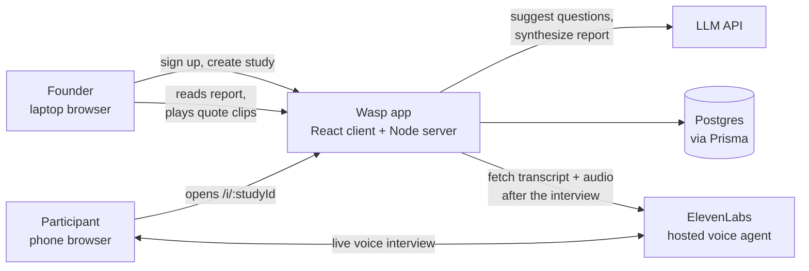
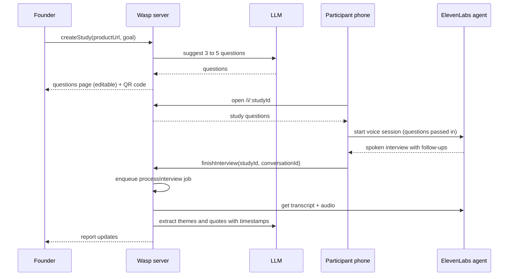
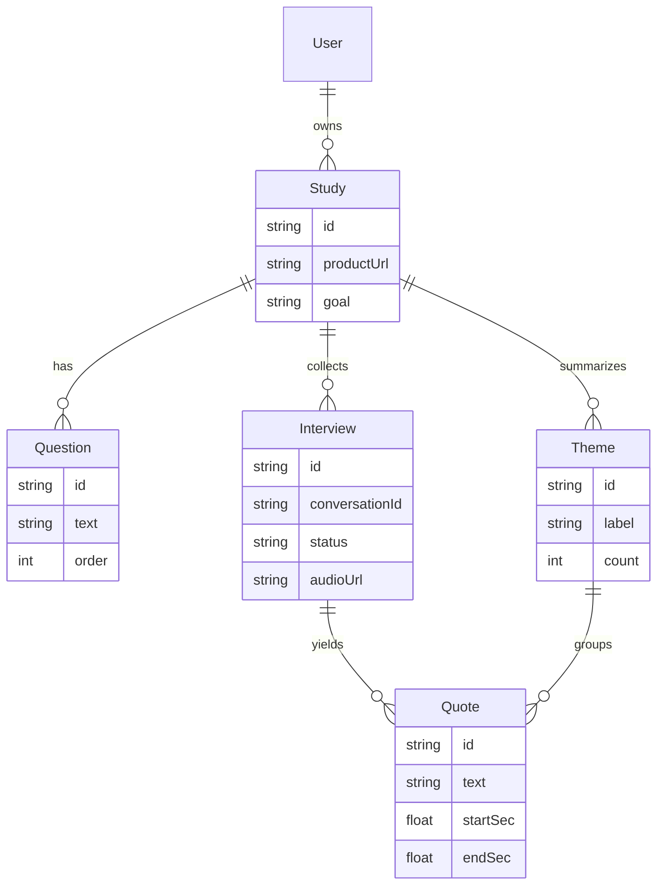

# Technical plan: user-interview agent

High-level plan for the idea in [IDEA.md](IDEA.md). It names the parts, how they connect, and who can build what in parallel. It is not a line-by-line spec.

Facts marked **verified** were checked against the Wasp 0.26 and ElevenLabs docs on 2026-11-22. Anything marked **check** is an assumption to confirm in the first 30 minutes.

## System at a glance



Two outside services, one app:

| Part | Does | Owner of the hard part |
| --- | --- | --- |
| **Wasp app** | Auth, pages, database, background job | Us |
| **ElevenLabs agent** | The whole spoken interview: listening, follow-ups, speaking | ElevenLabs |
| **LLM API** | Writes the questions; turns a transcript into themes and quotes | LLM provider |

## The agent loop



No human acts between "create study" and "report updates". That is the theme: one agent doing the researcher's whole job.

## Data model



- `Interview.status` moves `started` → `processing` → `done` (or `failed`).
- `Quote.startSec` is the offset into that interview's audio. A quote clip is the full audio played from that offset, so no audio is cut on the server.
- The schema is append-only once the skeleton lands: add fields and tables, never rename or reorder.

## Wasp pieces

| Wasp feature | Used for | Notes |
| --- | --- | --- |
| `main.wasp.ts` | Declares routes, pages, auth, operations, the job | **Verified**: 0.26 uses a TypeScript config file |
| Auth | Founder sign-up and login | Username and password. Email auth sends nothing in dev (**check**) |
| Entities (`schema.prisma`) | The data model above | **Verified** |
| Queries | `getStudies`, `getStudy`, `getReport`, `getPublicStudy` | `getPublicStudy` needs no login: participants don't sign up |
| Actions | `createStudy`, `updateQuestions`, `finishInterview` | `finishInterview` needs no login |
| Job | `processInterview` | **Verified**: jobs run on PgBoss and need Postgres, not the default SQLite |
| API route | Only if we switch to the ElevenLabs post-call webhook | Not needed in the default plan |

**Database**: Postgres from the first commit, because the job needs it. Use `wasp start db` (needs Docker) or a hosted Postgres connection string in `.env.server` as `DATABASE_URL`.

**Install**: `npm i -g @wasp.sh/wasp-cli@latest` (**verified**). Wasp also ships a coding-agent plugin: `claude plugin install wasp@wasp-agent-plugins --scope project`.

## ElevenLabs pieces

- **One agent, configured once** in the ElevenLabs dashboard. Its prompt has placeholders for the product, the goal, and the questions.
- **Per-interview values**: the phone passes that study's questions in when it starts the session, using dynamic variables or overrides (**check** which one the React SDK takes; both exist in the docs).
- **Client**: `@elevenlabs/react` `useConversation` with `startSession`, `onDisconnect`, and `getId` for the conversation ID (**verified** these exist).
- **After the call**: the server calls "get conversation details" for the transcript and "get conversation audio" for the recording (**verified** both endpoints exist). The transcript may take a few seconds to appear, so the job retries.
- **API key** stays on the server in `.env.server`. It never reaches the phone.

## Pages

| Route | Who | Shows |
| --- | --- | --- |
| `/login`, `/signup` | Founder | Wasp auth forms |
| `/` | Founder | List of studies, "new study" form (URL + goal) |
| `/study/:id/questions` | Founder | Suggested questions, editable; link and QR code |
| `/study/:id/report` | Founder | Interviews completed, themes with counts, quotes with play buttons |
| `/i/:studyId` | Participant | Start button, the on-screen character slot, live interview |

The character is one React component on `/i/:studyId` that receives "is the agent speaking" as a prop. Swapping or removing it must not touch the interview logic.

## Code layout

One folder per concern, so each person edits their own files:

```text
main.wasp.ts            shared: routes, auth, operations, job (one owner)
schema.prisma           shared: data model (one owner)
src/study/              founder pages + createStudy, updateQuestions
src/interview/          participant page, useConversation, finishInterview
src/report/             report page + getReport
src/agent/suggestQuestions.ts     plain TypeScript, no Wasp imports
src/agent/synthesizeInterview.ts  plain TypeScript, no Wasp imports
src/agent/elevenlabsClient.ts     transcript + audio fetch
src/character/          the on-screen character component
```

The three files in `src/agent/` take plain inputs and return plain objects. If we leave Wasp, they move to another stack unchanged.

## Who builds what, in parallel

| Track | Work | Depends on |
| --- | --- | --- |
| **A. Wasp skeleton** | Install, auth, schema, empty pages, the job wiring, phone reaches the app over HTTPS | Nothing |
| **B. Voice interview** | ElevenLabs agent prompt, `/i/:studyId` talking on a phone, conversation ID captured | Nothing (can start in a bare page) |
| **C. Agent brains** | `suggestQuestions`, `synthesizeInterview`, tested on a pasted transcript | Nothing |
| **D. Report + character** | Report page from fixture data, quote play buttons, the character | The data model |

Tracks B and C need no Wasp, so they are safe whichever stack we end on.

## Reaching the app from a phone

The phone needs HTTPS for the microphone, and Wasp dev runs the client and server on two ports.

- **First**: two tunnels (client and server) with `REACT_APP_API_URL` in `.env.client` and `WASP_WEB_CLIENT_URL` / `WASP_SERVER_URL` in `.env.server` (**verified** these variables exist).
- **Before strangers use it**: deploy once (`wasp deploy` supports Fly.io and Railway) so the QR code keeps working when a laptop sleeps.

## Risks, in order

1. **Interview in a loud hall.** Test one real phone interview before building anything else. Fallback: push-to-talk.
2. **Wasp is new to all of us.** The 30-minute check in [IDEA.md](IDEA.md) decides. Fallback: the same design on a stack we know; tracks B and C carry over.
3. **Two-port tunnels.** The most likely place to lose time. Fallback: deploy early.
4. **Transcript not ready when the job runs.** The job retries a few times before marking the interview `failed`.
5. **The character eats time.** It is last, and optional.

## Not building

Payments, participant recruiting, multiple languages, exports, team accounts, editing a report by hand.
