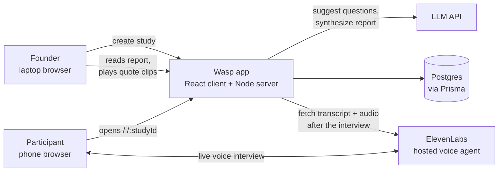
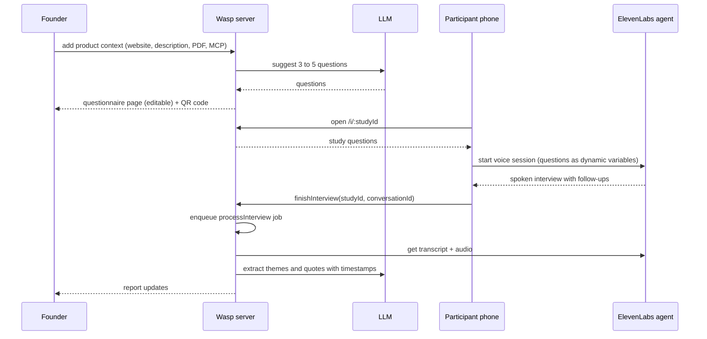
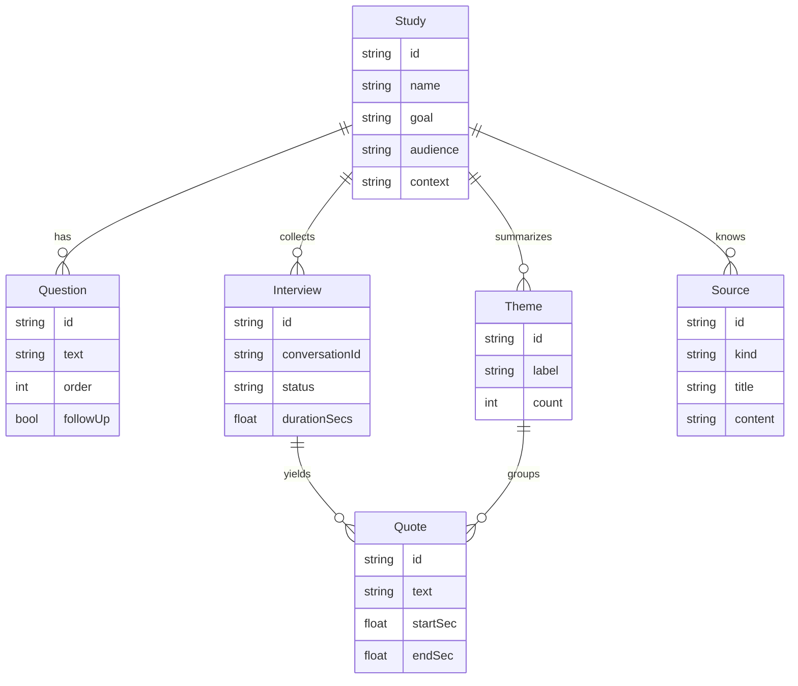

# Technical plan: user-interview agent

High-level plan for the idea in [IDEA.md](IDEA.md). It names the parts, how they connect, and who builds what. Files and owners are in [OWNERSHIP.md](OWNERSHIP.md).

Each section says what exists in the skeleton today and what is planned. Facts marked **verified** were checked against the Wasp 0.26 docs or the ElevenLabs SDK source on 2026-11-22; **check** means not confirmed yet.

## System at a glance

| Part | Does | Owner of the hard part |
| --- | --- | --- |
| **Wasp app** | Pages, database, background job | Us |
| **ElevenLabs agent** | The whole spoken interview: listening, follow-ups, speaking | ElevenLabs |
| **LLM API** | Writes the questions; turns a transcript into themes and quotes | LLM provider (not chosen yet) |

## The agent loop

No human acts between "create study" and "report updates". That is the theme: one agent doing the researcher's whole job.

## What exists today

- **Pages**: `/` creates a study from a URL and a goal (or a description) and lists studies. `/study/:studyId/knowledge` and `/study/:studyId/questionnaire` read and write the database; the questionnaire shows the interview link and QR code. `/study/:studyId/report` is mounted but still shows the skeleton's placeholder (track 3).
- **Operations** (`src/study/operations.ts`): `createStudy`, `getStudies`, `getStudy`, `updateStudy`, `addSource`, `deleteSource`, `getPublicStudy`, `finishInterview`, `getReport`, plus the skeleton's `importWebsite` and `importMcp` in `src/sources.ts`. No login on any of them.
- **Job and audio** (`src/jobs/`): `processInterview` polls ElevenLabs until the transcript is ready, writes themes and quotes, and marks the interview `done` or `failed`. `GET /api/interviews/:interviewId/audio` serves the recording with byte ranges, so the player can seek.
- **Seams for track 3**: `suggestQuestions` in `operations.ts` returns template questions, and `synthesizeInterview` in `processInterview.ts` turns each long answer into a quote under one theme. Each becomes one import from `src/agent/` when the LLM versions land.
- **Verified**: the founder flow in the browser through the HTTPS tunnel, and the job, report and audio ranges against a local fake ElevenLabs server. **Not yet verified**: a real ElevenLabs conversation, which needs `ELEVENLABS_API_KEY` and track 2's interview page.

## Data model

- `Study.context` is the joined text of the study's `Source` rows, rebuilt on every source change.
- `Interview.status` moves `processing` → `done` (or `failed`, with `error` set).
- `Quote.startSec` is the offset into that interview's audio. A quote clip is the full audio played from that offset, so no audio is cut on the server.
- The schema is append-only: add fields and tables, never rename or reorder.

## Wasp pieces

| Wasp feature | Used for | Status |
| --- | --- | --- |
| `main.wasp.ts` | Routes, operations, the job, the audio API | **Verified**: 0.26 uses a TypeScript config file |
| `schema.prisma` | The data model above, on Postgres | Migrations in `migrations/` |
| Queries | `getStudies`, `getStudy`, `getPublicStudy`, `getReport` | No login on any of them |
| Actions | `createStudy`, `updateStudy`, `addSource`, `deleteSource`, `finishInterview`, `importWebsite`, `importMcp` | `finishInterview` is called from the phone |
| Job | `processInterview` | **Verified**: jobs run on PgBoss and need Postgres |
| API route | `GET /api/interviews/:interviewId/audio` | Keeps the ElevenLabs key on the server |
| Auth | Not used | Sign-up is nice-to-have in IDEA.md |

**Database**: the local Postgres on port 5432: `createdb fieldwork`, set `DATABASE_URL` in `.env.server`, then `wasp db migrate-dev`. `wasp start db` also works but needs Docker.

**Run it**: Node 24.22.1 or newer (`nvm use 24.22.3`), Wasp CLI 0.26.1. Copy `.env.server.example` to `.env.server` and `.env.client.example` to `.env.client`, then `npm run dev` (client on 3002, server on 3003). `npm run check` runs `wasp compile`, which typechecks.

**Installed for the tracks**, pinned exactly: `@elevenlabs/react` 1.22.1 (track 2), `@elevenlabs/elevenlabs-js` 2.78.0 (track 1), `qrcode.react` 4.2.0 (track 2). `.npmrc` blocks package versions under 7 days old, so the newest release may not install.

## ElevenLabs pieces (track 2; transcript and audio fetch, track 1)

- **One agent, configured once** in the ElevenLabs dashboard. Its prompt uses the dynamic variables `product_url`, `goal`, and `questions` (types in `src/contract.ts`).
- **Per-interview values**: the phone passes them to `startSession` as `dynamicVariables`. **Verified** in the SDK source; this needs no overrides enabled on the agent.
- **Client**: `@elevenlabs/react` `useConversation` with `startSession`, `onDisconnect`, and `getId` for the conversation ID. **Verified**.
- **After the call**: the server calls "get conversation details" for the transcript and "get conversation audio" for the recording. Each transcript turn has `time_in_call_secs` (**verified**), which gives quotes their start time. The transcript may take a few seconds to appear, so the job retries.
- **API key** stays on the server in `.env.server`. It never reaches the phone.

## Pages

| Route | Who | Shows | Status |
| --- | --- | --- | --- |
| `/` | Founder | New study form (URL and goal), list of studies | Exists |
| `/study/:studyId/knowledge` | Founder | The study's knowledge sources | Exists |
| `/study/:studyId/questionnaire` | Founder | Goal, audience, editable questions, interview link and QR code | Exists |
| `/study/:studyId/report` | Founder | Interviews completed, themes with counts, quotes with play buttons | Route exists; page is track 3's |
| `/i/:studyId` | Participant | Start button, the character, the live interview | Planned, track 2 |

The character is one React component on `/i/:studyId` that takes `speaking` as a prop. Swapping or removing it must not touch the interview logic.

## Code layout

See the file tree in [OWNERSHIP.md](OWNERSHIP.md). `src/agent/` and `src/jobs/elevenlabsClient.ts` take plain inputs and return plain objects, with no Wasp imports, so they move to another stack unchanged.

## Tracks

| Track | Work | Depends on |
| --- | --- | --- |
| **1. Data and wiring** | Postgres, tables, study in the database, operations, the job with `elevenlabsClient` (transcript and audio fetch), audio route, HTTPS tunnels | Nothing |
| **2. Voice interview** | ElevenLabs agent, `/i/:studyId` on a phone, conversation ID captured, QR code, mounting the character | Track 1's `getPublicStudy` and `finishInterview`; hardcoded questions until then |
| **3. Brains and report** | `suggestQuestions`, `synthesizeInterview` tested on a pasted transcript, then the report page from fixture data shaped like `ReportView`, with quote playback | Track 1's `getReport`; fixtures until then |
| **4. Character** | The on-screen character: one component with a `speaking` prop | Nothing; track 2 mounts it |

## Reaching the app from a phone

The phone needs HTTPS for the microphone, and Wasp dev runs the client and server on two ports.

**Decision: no deploy.** The app runs on the presenting laptop with the local Postgres, and two HTTPS tunnels expose it to phones.

- **Tunnels**: `npm run tunnels` opens two cloudflared quick tunnels (3002 and 3003) and saves their URLs; then `npm run dev:tunnel` runs `wasp start --client-url ... --server-url ...` with them. **Verified**: Wasp 0.26 rejects `REACT_APP_API_URL`, `WASP_WEB_CLIENT_URL` and `WASP_SERVER_URL` in env files and takes these flags instead.
- **Keep them stable**: free tunnel URLs change on restart, which breaks the QR code. Start them once before the hall study and leave them running.
- **Order and host check**: start the tunnels first, since `dev:tunnel` reads their URLs. `vite.config.ts` allows `.trycloudflare.com` hosts (**verified** through a tunnel).
- **Keep the laptop up**: `caffeinate -is`, on power, with our phone hotspot as the network fallback.
- **Deploy** (`wasp deploy` to Railway or Fly) only if tunnels fail. Railway would provision its own Postgres.

## Risks, in order

1. **Interview in a loud hall.** Test one real phone interview before building anything else. Fallback: push-to-talk.
2. **Two-port tunnels.** The most likely place to lose time. Fallback: deploy to Railway.
3. **Transcript not ready when the job runs.** The job retries a few times before marking the interview `failed`.
4. **No LLM provider or key yet.** Blocks track 3.
5. **The character eats time.** It is last, and optional.

## Not building

Payments, participant recruiting, multiple languages, exports, team accounts, editing a report by hand.
