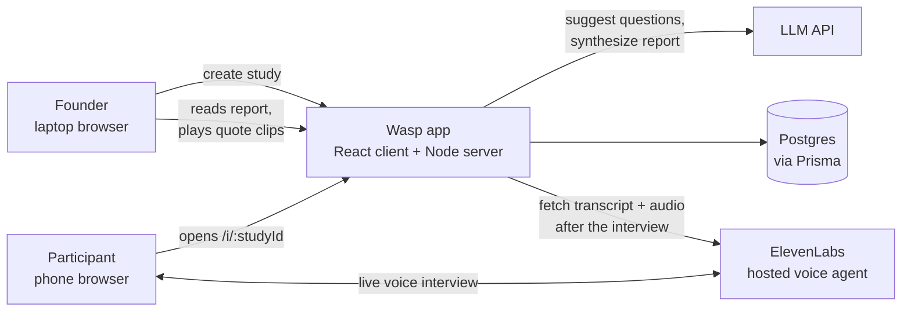
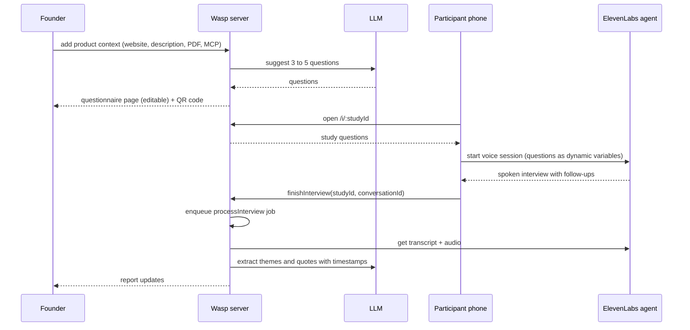
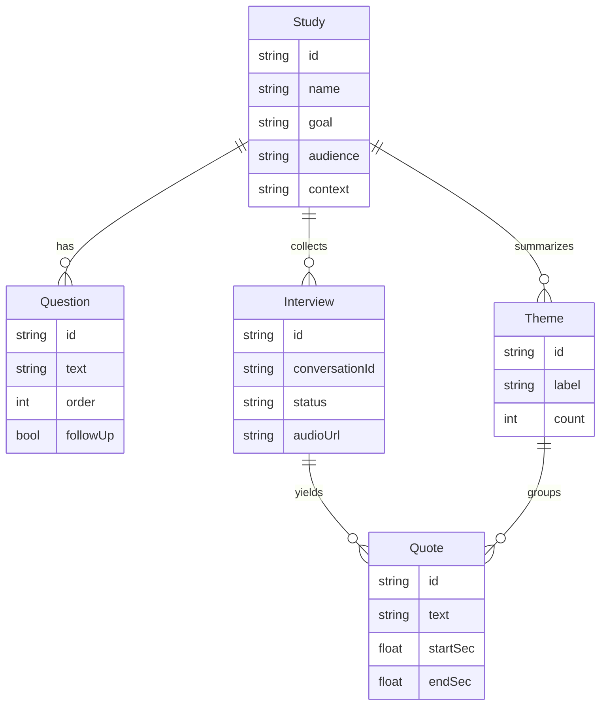

# Technical plan: user-interview agent

High-level plan for the idea in [IDEA.md](IDEA.md). It names the parts, how they connect, and who builds what. Files and owners are in [OWNERSHIP.md](OWNERSHIP.md).

Each section says what exists in the skeleton today and what is planned. Facts marked **verified** were checked against the Wasp 0.26 docs or the ElevenLabs SDK source on 2026-11-22; **check** means not confirmed yet.

## System at a glance

| Part | Does | Owner of the hard part |
| --- | --- | --- |
| **Wasp app** | Pages, database, background job | Us |
| **ElevenLabs agent** | The whole spoken interview: listening, follow-ups, speaking | ElevenLabs |
| **LLM API** | Writes the questions; turns a transcript into themes and quotes | LLM provider (not chosen yet) |

## The agent loop

No human acts between "create study" and "report updates". That is the theme: one agent doing the researcher's whole job.

## What the skeleton has today

- **Pages**: Knowledge base (`/` and `/knowledge`), Questionnaire (`/questionnaire`), Report (`/report`, empty states only).
- **Server actions**: `importWebsite` scrapes a public URL; `importMcp` reads text resources from an MCP server. PDF text is extracted in the browser.
- **State**: one study, held in browser storage (`src/store.ts`). Nothing is in the database yet.
- **Database**: SQLite with no tables.
- **Auth**: none.
- **Starter questions**: `starterQuestions` in `src/store.ts` fills in template questions; track 3 replaces it with the LLM.

## Data model (planned, track 1)

- `Study.context` is the joined text of the knowledge sources.
- `Interview.status` moves `started` → `processing` → `done` (or `failed`).
- `Quote.startSec` is the offset into that interview's audio. A quote clip is the full audio played from that offset, so no audio is cut on the server.
- The demo needs at least two studies, the judge's and the hall study, so the study leaves browser storage and gets an ID.
- The schema is append-only: add fields and tables, never rename or reorder.

## Wasp pieces

| Wasp feature | Used for | Status |
| --- | --- | --- |
| `main.wasp.ts` | Routes, operations, the job | Exists. **Verified**: 0.26 uses a TypeScript config file |
| `schema.prisma` | The data model above | Exists, empty, SQLite. Switch to Postgres |
| Queries | `getPublicStudy`, `getReport`, and whatever track 1 needs to load a study | Planned. No login on any of them |
| Actions | `importWebsite`, `importMcp` exist; `createStudy`, `updateQuestions`, `finishInterview` planned | `finishInterview` is called from the phone |
| Job | `processInterview` | Planned. **Verified**: jobs run on PgBoss and need Postgres |
| API route | Serves quote audio by proxying "get conversation audio", so the ElevenLabs key stays on the server | Planned |
| Auth | Not used | Sign-up is nice-to-have in IDEA.md |

**Database**: the local Postgres on port 5432 works; set `DATABASE_URL` in `.env.server`. `wasp start db` also works but needs Docker.

**Run it**: Node 24.22.1 or newer (`nvm use 24.22.3`), Wasp CLI 0.26.1, then `npm run dev` (client on 3002, server on 3003). `npm run check` runs `wasp compile`, which typechecks.

## ElevenLabs pieces (track 2, fetch helpers track 3)

- **One agent, configured once** in the ElevenLabs dashboard. Its prompt uses the dynamic variables `product_url`, `goal`, and `questions` (types in `src/contract.ts`).
- **Per-interview values**: the phone passes them to `startSession` as `dynamicVariables`. **Verified** in the SDK source; this needs no overrides enabled on the agent.
- **Client**: `@elevenlabs/react` `useConversation` with `startSession`, `onDisconnect`, and `getId` for the conversation ID. **Verified**.
- **After the call**: the server calls "get conversation details" for the transcript and "get conversation audio" for the recording. Each transcript turn has `time_in_call_secs` (**verified**), which gives quotes their start time. The transcript may take a few seconds to appear, so the job retries.
- **API key** stays on the server in `.env.server`. It never reaches the phone.

## Pages

| Route | Who | Shows | Status |
| --- | --- | --- | --- |
| `/`, `/knowledge` | Founder | Product context sources | Exists |
| `/questionnaire` | Founder | Goal, audience, editable questions; later the link and QR code | Exists |
| `/report` | Founder | Interviews completed, themes with counts, quotes with play buttons | Empty states only |
| `/i/:studyId` | Participant | Start button, the character, the live interview | Planned, track 2 |

How the founder routes carry a study ID is track 1's call.

The character is one React component on `/i/:studyId` that takes `speaking` as a prop. Swapping or removing it must not touch the interview logic.

## Code layout

See the file tree in [OWNERSHIP.md](OWNERSHIP.md). The three files in `src/agent/` take plain inputs and return plain objects, with no Wasp imports, so they move to another stack unchanged.

## Tracks

| Track | Work | Depends on |
| --- | --- | --- |
| **1. Data and wiring** | Postgres, tables, study in the database, operations, job, audio route, deploy | Nothing |
| **2. Voice interview** | ElevenLabs agent, `/i/:studyId` on a phone, conversation ID captured, QR code | Track 1's `getPublicStudy` and `finishInterview`; hardcoded questions until then |
| **3. Agent brains** | `suggestQuestions`, `synthesizeInterview`, `elevenlabsClient`, tested on a pasted transcript | Nothing |
| **4. Report and character** | Report page from fixture data shaped like `ReportView`, quote playback, the character | Track 1's `getReport`; fixtures until then |

## Reaching the app from a phone

The phone needs HTTPS for the microphone, and Wasp dev runs the client and server on two ports.

- **First**: two tunnels (client and server) with `REACT_APP_API_URL` in `.env.client` and `WASP_WEB_CLIENT_URL` / `WASP_SERVER_URL` in `.env.server` (**verified** these variables exist).
- **Before strangers use it**: deploy once (`wasp deploy` supports Fly.io and Railway) so the QR code keeps working when a laptop sleeps.

## Risks, in order

1. **Interview in a loud hall.** Test one real phone interview before building anything else. Fallback: push-to-talk.
2. **Two-port tunnels.** The most likely place to lose time. Fallback: deploy early.
3. **Transcript not ready when the job runs.** The job retries a few times before marking the interview `failed`.
4. **No LLM provider or key yet.** Blocks track 3.
5. **The character eats time.** It is last, and optional.

## Not building

Payments, participant recruiting, multiple languages, exports, team accounts, editing a report by hand.
